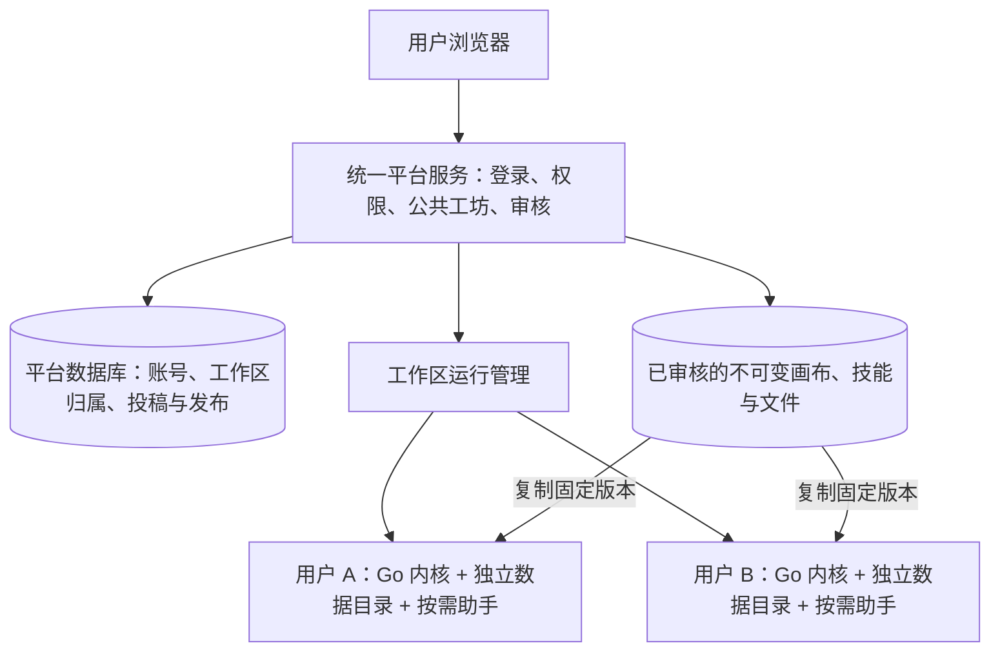

# 多人服务器与公共创意工坊方案

> 本文是初版草案，已由[团队服务器与创意工坊方案](team-server-and-workshop.md)取代。两者的主要差异是运行模型（同进程多内核，而不是每个工作区一个容器）、服务器形态下已有的安全缺口、工坊快照与复制的具体规则，详见新文档第 11 节。

状态：架构建议，尚未实施。审查基于 `a6a3a37` 的实际入口与消费链路，不把历史托管版注释、页面按钮或测试替身当作现有服务器能力。

## 1. 需求与结论

已确认规模：**10–30 人的内部团队**。本方案暂按管理员分配账号、每人一个私有工作区、公共区仅登录后可见设计。这里的“官方”指本平台管理员确认的发布身份。

目标：

- 每个用户拥有独立项目、画布、文件、模型配置、任务与助手记录。
- 首页“创作工坊”展示他人或官方分享、审核通过的画布；可只读查看全部发布内容，并复制到自己的工作区。
- 项目页提供投稿入口；技能页提供公共市场、私人技能和自己的投稿。
- 管理员可审阅项目/技能的确切版本、通过、驳回和下架。

**当前后端不能直接满足。推荐第一版增加统一平台服务，复用现有单工作区内核，但按个人工作区隔离运行；公共发布和审核在统一平台管理。** 不把单机 owner 凭据当作网站登录，不直接把现有开发代理发布到公网。

本期不包含多人同时编辑同一画布、团队共享私有工作区、商业计费、多地域部署或复杂推荐系统。

## 2. 当前能力核实

| 需求 | 现状与证据 | 判断 |
| --- | --- | --- |
| 浏览器 / 服务器进程 | [server/main.go](../backend/cmd/server/main.go#L31) 使用 `ProfileServer`，但 [bootstrap/runtime.go](../backend/internal/bootstrap/runtime.go#L104) 仍执行本地迁移并创建 `app.NewLocal` | 能运行 HTTP 服务，不代表具备多用户能力 |
| 登录与真实账号 | [local_identity.go](../backend/internal/handler/local_identity.go#L10) 不读登录 Cookie；[workspace/service.go](../backend/internal/workspace/service.go#L56) 将工作区映射为固定 `local/admin` 用户 | 缺少网站账号、登录会话与平台管理员边界 |
| 每人独立工作区 | [workspace_context.go](../backend/internal/handler/workspace_context.go#L13) 注入启动时固定的上下文；[models_workspace.go](../backend/internal/model/models_workspace.go#L5) 明确单安装所有权，旧 `user_id` 实际存工作区 ID | 不能把不同浏览器自动分到不同空间 |
| 历史托管版能力 | [local_schema.go](../backend/internal/database/local_schema.go#L630) 删除 `users`、`auth_sessions`、`canvas_shares` 等旧表 | 不能用旧托管数据库直接运行当前迁移，也不能靠恢复几个路由启用多人版 |
| 数据库 | [database.go](../backend/internal/database/database.go#L18) 只支持 SQLite，连接池限制为一个连接 | 适合当前独立工作区；不能通过环境变量直接切到 PostgreSQL |
| 数据归属校验 | [canvas_library.go](../backend/internal/repository/canvas_library.go#L27)、[asset/service.go](../backend/internal/asset/service.go#L166) 已按 owner 查资源 | 可复用领域校验，但它没有替代网站登录 |
| 只读画布界面 | [project.tsx](../web/src/pages/canvas/project.tsx#L196) 通过 URL 的 `readonly` / `mode` 控制界面 | 可复用显示与交互，不能充当公开内容的服务端权限 |
| 画布复制 | [canvas-export.ts](../web/src/lib/canvas/canvas-export.ts)、[canvas-archive-restore.ts](../web/src/lib/canvas/canvas-archive-restore.ts#L296) 已有媒体还原和引用改写；[canvas/archive.go](../backend/internal/canvas/archive.go#L27) 有服务端 ZIP 输出 | 可复用格式和校验思路，尚无公开版本到个人空间的完整后台复制事务 |
| 画布全部文件 | 服务端 ZIP 当前遇到 `drawingId` 会拒绝；画板另有 [canvas/library.go](../backend/internal/canvas/library.go#L212) 数据读取路径 | 投稿必须补充完整依赖收集，不能直接把现有 ZIP 输出当成完整发布合同 |
| 技能市场和投稿 | [skills_market.go](../backend/internal/handler/skills_market.go) 有浏览、安装、投稿准备/上传/提交；[skillhub/client.go](../backend/internal/skillhub/client.go#L1) 明确是外部市场客户端 | 可复用前端与文件/版本校验；默认市场是外部 BeefTV 服务 |
| 本站审核后台 | 现有 [router.tsx](../web/src/router.tsx) 和 [handler/api.go](../backend/internal/handler/api.go) 未注册本站公共内容审核界面与发布管理端 | 需要新建；显示审核结果不等于具有审稿功能 |
| 模型与助手隔离 | [provider_config.go](../backend/internal/workspace/provider_config.go#L18) 以数据目录保存渠道配置；[agent-host/server.mjs](../agent-host/server.mjs#L30) 启动时固定模型、凭据、数据目录 | 必须按工作区运行，不能让多个用户共用同一宿主并切换全局配置 |
| 容器部署 | [backend/Dockerfile](../backend/Dockerfile) 带 Go 和插件，但未装配助手 Node/依赖及完整媒体运行组件；Compose 使用一个共享数据卷 | 现有容器配置也不是完整多人部署方案 |

另：[workspace-mode.ts](../web/src/services/workspace-mode.ts#L13) 当前始终返回本地模式，`CANVAS_LOCAL_MODE` / `CANVAS_REGISTRATION_ENABLED` 在 Compose 中出现，并不能据此认定 Go 已实现对应切换。

## 3. 推荐结构与取舍

第一版保持一个仓库、一个平台服务和统一部署，不拆成多个业务微服务。平台数据推荐 PostgreSQL；每个私有工作区继续使用自己的 SQLite 与资源目录。公开文件在单机阶段可放专用持久目录，通过受控文件接口访问；跨机器扩容时再接对象存储。

这是针对当前代码和已确认规模的选择，不是“SQLite 无法支持多人网站”。SQLite 官方将本地应用存储与高并发集中式存储区分开；独立数据库应由所属服务本地访问，不挂成供多台机器同时写入的网络文件。[SQLite 官方说明](https://sqlite.org/whentouse.html)

| 方案 | 成本与风险 | 本期建议 |
| --- | --- | --- |
| 给现有服务加登录页，所有用户继续共用同一内核和数据目录 | 当前身份、凭据、助手、文件路径都仍共享，容易串数据 | 不采用 |
| 统一平台 + 每工作区隔离内核 | 复用现有单机领域逻辑；增加入口授权、运行管理和公共发布服务；有一定进程/内存开销 | **优先采用** |
| 所有私有数据改为同库多租户 | 需要重新梳理查询、后台任务、文件、缓存、助手与密钥的每条归属路径 | 用户规模或协作需求扩大后再评估，不能只加 `workspace_id` 一列 |

运行管理按需拉起工作区，助手仅在使用时启动。退出空闲工作区前检查所有任务和助手回合；正在执行或取回结果时不能休眠。按工作区建立启动锁，避免两个内核同时写同一个数据库。10–30 人是产品规模，不是已测容量；上线前测实际内存、媒体任务并发和磁盘压力。

隔离需要容器或等价的 OS 边界：每个内核只挂自己的可写目录，代码和官方插件只读，不挂平台凭据、其他用户目录或容器控制接口。仅把文件放到不同文件夹、但让同一个高权限进程任意读取所有目录，不构成可靠隔离。

## 4. 登录、路由与管理员边界

平台新增 `users`、登录会话和 `workspaces(owner_user_id)`；第一版每人一个工作区，不提前设计团队角色体系。已有企业登录可接成熟身份服务；没有时由管理员创建/邀请账号，禁用公开注册，并使用成熟的密码与会话方案。

- 浏览器只访问统一 HTTPS 入口，使用服务端会话；写请求校验 CSRF 与来源。
- 请求目标工作区由已验证账号和平台记录确定。客户端提供的 ID、Header、Cookie 名称或路径不能自行授权访问别人的内核。
- 内核不公开端口。平台到内核使用按工作区独立、可轮换的服务凭据；浏览器拿不到 owner 或助手宿主密钥。
- 当前操作和助手入口还检查回环来源。服务器版需增加经过认证的平台代理适配层，集中验证服务身份与固定工作区，再进入既有业务权限链；容器间通信不能靠伪造 `RemoteAddr` / `Origin` 或放行全部内网 IP 绕过校验。这是第 1 阶段的实际改造，普通反向代理本身不能解决。
- 既有 `local/admin` 只表示该内核的工作区所有者，不能转成平台管理员。普通用户无法审核公共内容、管理其他账号或查看其他用户私有项目。
- 平台管理端默认只读取投稿快照。排障进入私有工作区需要另行授权与记录，不能因“管理员”身份自动开放全部私人内容。
- 代理采用允许的业务路由与方法清单。**不能把 `X-Beeftv-Owner` 加到所有请求上**：当前 `/assistant/host/config` 可写启动命令，存储迁移、桌面更新、客户端凭据管理、本机文件选择等接口也必须单独关闭或改造。
- 当前 Vite owner 转发和 `BEEFTV_UI_BOOTSTRAP=1` 是本机开发机制，不用于正式服务器。入口不能只凭“来自回环地址”信任反代后的所有请求。
- 平台 bootstrap 返回真实账号、工作区和能力；前端缓存以账号与工作区共同分区。退出/换账号时清理状态、取消旧请求、断开事件流。不能继续把所有浏览器标成 `local`。

文件、缩略图、视频 Range、上传分块、SSE、任务查询、导出、诊断与助手历史都要执行同样的归属校验，不能只保护列表页。这与 OWASP 的默认拒绝、每次请求校验和静态资源授权原则一致。[OWASP 授权指南](https://cheatsheetseries.owasp.org/cheatsheets/Authorization_Cheat_Sheet.html)

私人媒体还需单独调整缓存策略：当前图片接口允许长时间浏览器缓存，不能把它原样当作多人站点的隔离保证。地址与缓存键应带工作区范围，私人响应按会话安全要求重新验证或禁存，并测试同一浏览器退出 A 后登录 B 的行为。公共发布文件另有版本化地址和下架策略。

## 5. 公共画布：审核的是固定版本

**私有画布 → 生成投稿快照 → 管理员审核该版本 → 发布到创意工坊 → 只读浏览 → 复制成个人副本。**

不在私人画布上简单设置 `public=true`。原作者提交后可以继续修改私人画布，但公开版本不变；更新公共内容必须再次提交新版本审核。这样不会出现审核之后内容偷偷变化，也不会因私人素材删除而让公开画布失效。

### 投稿快照

以已保存的画布版本为起点，收集节点、连线、提示词、时间线、画板、导演场景、工作流定义及其实际引用的图片/视频/音频/模型文件。多个关联子画布也必须明确包含范围。收集器按节点类型逐项定义依赖，不能只递归搜索一个 `storageKey` 字段。

所有文件先确认为就绪、可读取并属于提交人；浏览器私有文件与临时 `blob:` 地址先落到服务端。缺失、无权使用、不可取得的外链，或暂不支持的节点依赖，应具体指出并阻止投稿，不能发布一个缺文件的“完整画布”。现有画板服务可用于补齐服务端导出缺口。

公开数据使用明确字段清单。保留作品内容和可复现参数；排除账号、渠道密钥、私有路径、签名链接、原任务权限、运行状态、完整助手历史和调试日志。投稿前展示实际将公开的内容与文件清单，确认提示词、素材和说明的授权；不把整个用户工作区直接打包公开。

### 浏览与文件

新增独立的公共画布入口，例如 `/workshop/projects/:publicationId/versions/:versionId`。可复用现有画布显示组件及 `readOnly` 交互，但使用独立只读数据加载器；不接私人自动保存、生成、助手写操作、拖拽上传和恢复任务。

服务端只读接口按“已发布版本 + 该版本文件清单”取文件，禁止传任意私人资源 ID。草稿预览仅投稿人和审核人可见；文件接口、缩略图与下载也检查状态。下架后停止新浏览/复制并处理缓存失效；已看过或下载的内容无法从用户设备收回。

只读指不能修改公开原件，仍可缩放、播放、查看内容和按发布规则下载。公开 HTML、SVG、Markdown 和技能附件不能直接作为同源可执行页面加载；采用安全预览或附件下载，禁止自动运行随稿脚本。

### 复制到我的工作区

服务器创建后台复制任务，输入固定 `publicationVersionId` 和目标工作区，不让浏览器下载后再上传全部大视频。

1. 重新确认版本仍可复制、目标空间属于用户、存储额度足够，并锁定本次复制的发布内容。
2. 在暂存区复制媒体，生成目标资源和项目身份，重写节点、连线、画板、时间线、子画布等内部引用。
3. 清除原作者任务/助手执行身份、旧运行状态与私有渠道绑定；模型参数可以保留，实际生成使用接收人的配置。
4. 核对全部文件和引用后，一次让新项目可见；失败只清理本次暂存内容。平台数据库与用户 SQLite 不能假装有跨库原子事务，需用任务状态和持久完成回执恢复。
5. 同一复制请求重复提交返回同一副本；用户主动“再复制一份”才新建。保留来源、作者和发布版本信息。

首版采用物理复制，简单且没有跨用户删除依赖；复制后的编辑、原作者删除或公共版本下架，都不破坏已经完成的个人副本。后续需要去重时再设计不可变对象引用和回收规则。

## 6. 技能市场与审核

保留现有“技能市场 / 我的技能 / 我的投稿”交互和版本校验能力。当前市场是外部服务；为本站增加自有目录、稿件、审核和发布接口，不能只修改 `BEEFTV_SKILLHUB_URL` 并期待功能自动出现。

复用 `skillhub` 的版本、文件摘要、归档校验以及 `skills/market_publishing.go` 的预览确认思路。通过窄的服务端适配器连接本站市场；Web 用户使用平台登录身份，不再需要前往外部 BeefTV 站点授权。保留桌面使用外部市场的既有入口，明确区分内容来源，作者信息不能靠字符串替换变成“官方”。

项目与技能共用投稿状态、审核操作和日志；内容验证分开实现：项目验证完整依赖图，技能验证说明、附件、工具要求与包结构。公共技能首版遵循现有约束，不接收可执行脚本或私有配置。审核通过不意味着安全地自动运行；安装后仍由用户选择使用，付费操作继续确认。

## 7. 页面与数据模型

页面调整：

- 首页“创作工坊”改为公共画布卡片，支持“官方 / 用户分享”、搜索、封面、作者与简介。原七项能力入口移到“新建项目”操作入口，保留可达性。
- 项目页增加“投稿到创意工坊”，首版一次提交一个项目；在“我的投稿”看状态、驳回意见和更新版本。
- 公共画布顶部固定显示“只读”、作者、版本和“复制到我的工作区”；复制完成后提供打开副本按钮。
- 技能页保留现有三个栏目，数据源转接本站公共市场。
- 管理员专属“内容审核”页：项目/技能队列、预览、文件清单、变更内容、通过/驳回/下架、操作记录。“官方”标记只能由管理员设置。

平台数据库建议的最小实体：

| 实体 | 核心职责 |
| --- | --- |
| `users` / `auth_sessions` | 真实账号、平台角色、禁用与会话 |
| `workspaces` | 用户归属、内核与数据目录映射、运行状态、额度 |
| `publications` | 内容类型（project/skill）、作者、官方标记、当前公开版本 |
| `publication_versions` | 不可变清单、内容摘要、文件集合与版本说明 |
| `submissions` | 确切版本、提交人、审核状态；不可审阅后替换内容 |
| `reviews` | 审核人、结论、原因和被审核的摘要；追加记录 |
| `copy_jobs` | 目标工作区、来源版本、重复请求标识、进度与完成回执 |

可见状态建议：准备中 → 待审核 → 已通过/已驳回/已撤回；发布后的版本另有已上架/已下架状态。审核确认绑定版本和摘要，采用状态条件更新，防止两名管理员并发操作或旧页面批准了新稿。

所有额度按平台身份生效：存储、上传大小、活跃任务与媒体处理并发分别控制。多个个人内核共用一个公司模型渠道时，还需在统一模型入口限制总并发，不能把各内核的并发数简单相加。第一版无需建设支付系统。

## 8. 分期与验收

| 阶段 | 实施范围 | 完成条件 |
| --- | --- | --- |
| 1. 多人运行底座 | 新增平台入口、账号、工作区分配、隔离运行和完整镜像；扩展前端 bootstrap | A/B 两账号各自保存、生成、使用助手；互猜 ID、资源 URL、任务和会话均不能越权；重启后各自恢复 |
| 2. 公共画布闭环 | 完整快照、项目投稿、只读浏览、文件访问、后台复制 | 图片/视频/音频/画板/时间线样本均完整；访客不能写；副本可独立编辑；原作者删除不破坏公开版本与副本 |
| 3. 审核与技能接入 | 统一管理员队列、技能市场适配、审核日志与版本更新 | 审核前不可公开；驳回原因可见；版本变化需重审；官方身份不可伪造 |
| 4. 内部试运行 | 配额、总并发限制、备份恢复、日志与部署运维 | 以目标人数跑保存/上传/生成混合负载，验证磁盘满、进程重启、断网、复制中断和完整恢复 |

第 2 阶段可以先由管理员发布样例画布用于联调，但不得在第 3 阶段审核完成前开放用户自动公开投稿。

改动落点建议：新增 `backend/cmd/platform` 作为独立入口，平台身份、公共发布与运行管理放在独立领域包；保留现有 `cmd/server` / `cmd/desktop` 单工作区边界。平台使用独立数据库与迁移，绝不调用会删除托管表的 `MigrateLocalSchema`。公用画布显示与序列化按真实共性提取，避免复制整个编辑器。

如果以后选择共享数据库多租户方案，须完整审计资源、异步任务、助手和缓存的租户上下文；可以使用 PostgreSQL 行级策略作第二层保护，但表 owner / 超级用户等有绕过规则，应用授权仍不可省略。[PostgreSQL 官方说明](https://www.postgresql.org/docs/current/ddl-rowsecurity.html)

实施前还需确定三个产品选项：账号由管理员分配还是接企业登录；模型算力统一供给还是各人配置；分享作品是否允许下载与再投稿。这些不改变“私有工作区隔离 + 固定版本发布 + 独立复制”的核心结构。

本轮仅完成源码与依赖边界审查、方案整理；未部署多人服务、未做容量压测，也未改变现有项目或用户数据。
