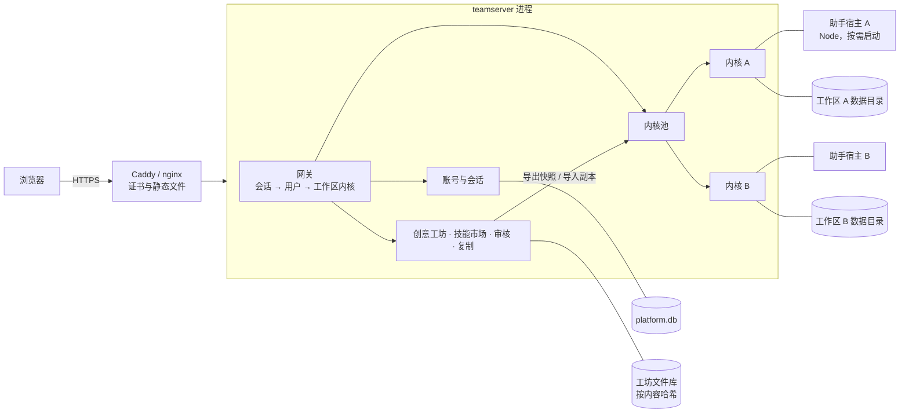
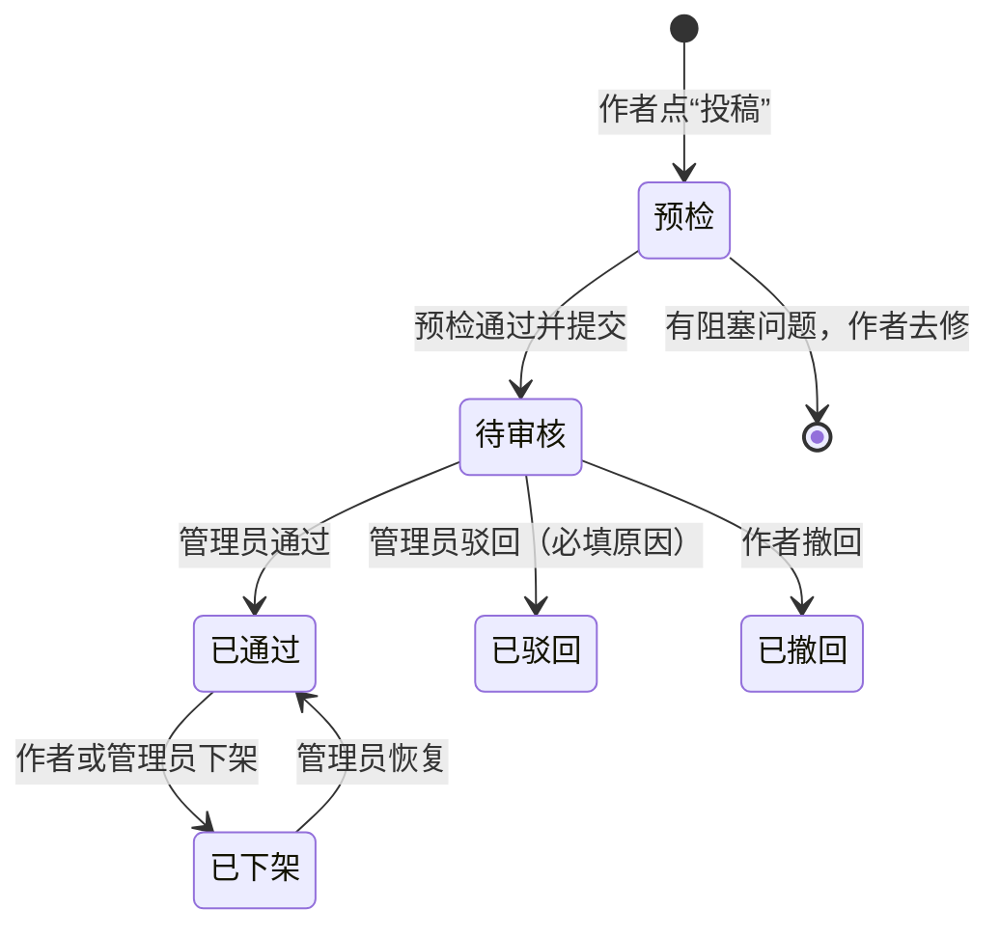

# 多人服务器与创意工坊：推荐方案

状态：第一期“多人底座”和第三期“技能市场”已实施（见第 12 节），第二期创意工坊与第四期加固尚未实施。结论基于源码核对，涉及“按代码推断”的地方会单独注明；镜像尚未在真实服务器上构建与压测。实施中核对出的修订汇总在第 12 节，运行与部署说明见 [团队服务器](content/docs/backend/team-server.mdx)。初版方案见 [server-workspaces-and-community.md](server-workspaces-and-community.md)，两者差异汇总在第 11 节。

本文假设的使用场景：10–30 人的内部团队，账号由管理员分配，每人一个私有工作区；创意工坊和技能市场只对已登录用户可见。规模或开放范围变化时，第 2 节说明什么时候需要换架构。

## 0. 一页结论

**现在的后端不能直接给多人用。** 最要紧的三个事实：

1. 服务器形态没有登录，也没有任何鉴权。能访问到端口的人就等于工作区所有者。
2. 一个后端进程只有一个工作区，所有人会落进同一个工作区，看到同一批项目、模型密钥和助手会话。
3. 现有 Compose 部署本身也跑不通完整功能：画布保存需要 owner 令牌，nginx 没有注入，按代码推断保存会被拒绝；镜像里没有助手宿主需要的 Node 和媒体处理需要的 ffmpeg；默认还允许服务器访问内网地址，多人环境下这就是 SSRF 入口。

**好消息是内核本来就是“按工作区隔离”的形状。** 每张业务表都有 `user_id`（本地模式下存的是工作区 ID），素材文件按 `resources/users/<工作区ID>/` 分目录，模型配置、加密密钥、助手宿主、外部凭据都挂在数据目录下。前端也整体按“一个本地工作区”工作。

**推荐方案：一个服务进程，内含“平台层 + 每人一个工作区内核”。**

- 每个用户的工作区就是一份现在的单机数据目录（独立 SQLite、独立素材目录、独立模型配置、独立助手进程），由同一个进程按需加载。
- 平台层负责登录、把请求转给“这个人的内核”、创意工坊、技能市场和审核。
- 内核只加一个“托管模式”开关和一个可信入口，业务代码基本不动，桌面版不受影响。
- 前端继续按“本地工作区”工作，只新增登录、创意工坊、投稿、审核几个页面。

**创意工坊**：投稿时生成一份不可变快照，管理员审核的就是这份快照；通过后所有登录用户可以只读浏览全部内容，一键复制到自己的工作区。复制在服务器端完成，同一块磁盘上用硬链接，几秒完成，不额外占空间。

**技能市场**：平台实现现有 SkillHub v1 接口并加上审核；审核通过的版本由平台私钥签名，内核只安装签过名的版本。现有的“技能市场 / 我的技能 / 我的投稿”三个标签页和安装、投稿流程基本不用改。

**模型算力**：接公司现有的模型中转站。管理员开账号时绑定此人在中转站的个人密钥，平台把它作为“公司中转站”渠道写进这个人的工作区；用量和额度在中转站按人统计。

**分四期**，第二期结束就能内部试用“投稿 → 审核 → 浏览 → 复制”完整闭环。已确认的四项决定见第 10 节。

## 1. 现状核实

| 需求 | 现状与证据 | 结论 |
| --- | --- | --- |
| 登录与鉴权 | 启动令牌只在桌面形态生成（[runtime.go](../backend/internal/bootstrap/runtime.go#L187)）；服务器形态下写接口的身份检查直接放行（[agent_ops.go](../backend/internal/handler/agent_ops.go#L212)）；启动日志自己写着 “server profile has no launch token”（[main.go](../backend/cmd/server/main.go#L85)） | 没有任何鉴权，必须新增 |
| 多个工作区 | 中间件注入启动时固定的一个工作区（[workspace_context.go](../backend/internal/handler/workspace_context.go#L13)）；身份规则是“一个安装一个所有者”（[workspace/service.go](../backend/internal/workspace/service.go#L16)） | 一个进程只服务一个工作区 |
| 画布保存 | 保存走 `/api/ops/canvas.document.commit`（[operations.ts](../web/src/services/api/operations.ts#L30)），服务器形态下需要 `X-Beeftv-Owner` 或本机回环（[agent_ops.go](../backend/internal/handler/agent_ops.go#L163)）；nginx 只是转发（[nginx.conf](../nginx.conf#L83)） | 按代码推断，Compose 部署里保存画布会返回“身份无法识别” |
| 出站访问 | Compose 默认 `CANVAS_ALLOW_PRIVATE_UPSTREAMS=true`（[docker-compose.yml](../docker-compose.yml#L21)） | 多人环境必须关闭，否则用户能让服务器访问内网或本机其他端口 |
| 数据归属 | 旧 `user_id` 列存工作区 ID（[models_workspace.go](../backend/internal/model/models_workspace.go#L5)）；仓储层约 280 处按 `user_id` 过滤；素材键为 `users/<id>/<kind>/日期/<id>`（[identity.go](../backend/internal/asset/identity.go#L130)） | 领域数据天然按工作区隔离，可直接复用 |
| 模型配置与密钥 | 加密文件存于数据目录（[provider_config.go](../backend/internal/workspace/provider_config.go#L18)），密钥用数据目录里的 `.settings-key` | 每个工作区一份，天然隔离 |
| 创作助手 | 每个运行时一个宿主子进程，模型和凭据在启动时固定（[host.go](../backend/internal/assistantruntime/host.go#L31)）；工具只有业务操作和计划/技能工具，没有 shell 或文件工具（[durable-session-owner.mjs](../agent-host/durable-session-owner.mjs#L464)） | 按工作区各起一个即可；模型无法借助手执行任意命令 |
| 危险的本机接口 | 宿主启动命令可通过 `PUT /assistant/host/config` 写入（[agent_host_lifecycle.go](../backend/internal/handler/agent_host_lifecycle.go#L44)）；另有 Eagle 本机素材库、深度组件安装、外部 Agent 凭据签发 | 托管模式必须不注册这些接口 |
| 管理员身份 | 当前身份永远是 admin（[workspace/service.go](../backend/internal/workspace/service.go#L58)），插件安装、卸载等管理员操作因此对任何调用者开放 | 托管模式下成员不能拿到这些能力 |
| 公开资源地址 | 签名地址的生成代码还在（[resource.go](../backend/internal/app/resource.go#L110)），但 `/api/public/resources/*` 路由在本地路由图里没有注册，测试明确禁止注册（[api_test.go](../backend/internal/handler/api_test.go#L112)）；本地模式需要公网地址的协议走工作区的参考素材对象存储，其余内嵌 | 不新开匿名路由；平台给每个工作区下发同一份对象存储配置（第 12 节） |
| 只读画布 | `?readonly=1` 只是视觉只读：自动保存、拖放上传、键盘删除都没关，连平移缩放也被禁用（[project.tsx](../web/src/pages/canvas/project.tsx#L196)） | 不能用来做公开浏览 |
| 纯渲染预览 | [canvas-version-preview.tsx](../web/src/pages/canvas/canvas-version-preview.tsx) 接收内存中的画布、回调全是空操作、可平移缩放；非媒体节点目前只渲染成文本卡片 | 适合作为只读查看器的起点 |
| 导出 / 导入格式 | v4 压缩包含完整画布（节点、连线、时间线、导演台场景、画板、外观，**也包括助手会话 `chatSessions`**），导入时改写全部媒体引用并支持回滚（[canvas-export.ts](../web/src/lib/canvas/canvas-export.ts)、[canvas-archive-restore.ts](../web/src/lib/canvas/canvas-archive-restore.ts)）；导入完全由前端编排，服务端没有导入功能 | 快照与复制沿用这套格式和改写规则，但助手会话必须剥离，导入要移植到服务端 |
| 服务端打包 | 只导出单张画布；遇到画板直接报错（[archive.go](../backend/internal/canvas/archive.go#L44)），但画板早已存进 `canvas_drawings` 表；只收集 `storageKey`，只用 URL 引用的媒体会被静默漏掉。前端导入同样只认 `storageKey`，并要求文件清单和 `storageKey` 引用一一对应（[canvas-export.ts](../web/src/lib/canvas/canvas-export.ts#L268)） | 快照导出需要重写依赖收集，而且导出和导入必须一起改：只把 URL 引用的媒体加进清单，整包都会被现有导入拒收 |
| 画布保存校验 | 图片、视频、音频节点必须带 `assetId`，指向本工作区一条引用该资源的素材记录，否则保存被拒（[library_canvas_guard.go](../backend/internal/asset/library_canvas_guard.go#L17)） | 复制时不能只建资源文件，还要建素材记录并改写 `assetId` |
| 项目副本 | 已修复（提交 `da0e99c`）：复制移入 [local-workspace-project-duplicate.ts](../web/src/services/local-workspace-project-duplicate.ts)，带上时间线、导演台、外观并按画布复制画板，失败回滚 | 仍由前端编排；工坊复制需要服务端实现，做好后“创建副本”可改用它 |
| 技能市场 | 客户端连外部 BeefTV SkillHub（[client.go](../backend/internal/skillhub/client.go#L16)），支持设备码授权（[market_auth.go](../backend/internal/skills/market_auth.go)）和 Ed25519 签名校验（[trust.go](../backend/internal/skillhub/trust.go#L14)）；允许 `http://127.0.0.1` 作为市场地址（[client.go](../backend/internal/skillhub/client.go#L148)） | 平台实现同一套接口即可复用客户端与前端 |
| 审核后台 | 路由里没有 `/login`、`/admin`；技能审核在外部网站完成 | 需要新建 |
| 前端身份 | 启动接口失败时回落到写死的 `local` 身份（[workspace-bootstrap-hydrator.tsx](../web/src/components/workspace/workspace-bootstrap-hydrator.tsx#L91)）；缓存隔离键用工作区 ID（[user-session.ts](../web/src/lib/user-session.ts#L36)）；切换身份时 React Query 不清空 | 多人前必须改成“失败即回登录页”，并按账号隔离缓存 |
| 本机存储违规 | 项目封面以 dataURL 存进不分用户的 `localStorage`（[canvas-folder-card.tsx](../web/src/components/canvas/canvas-folder-card.tsx#L43)） | 改为服务器保存 |
| 列表性能 | 项目页每次挂载都并行拉取全部画布全文，最多 500 个（[local-workspace-repository.ts](../web/src/services/local-workspace-repository.ts#L918)） | 本机无感，走公网会明显变慢，第一期一并改成摘要列表 |
| 容器镜像 | 后端镜像只有 Go 程序和插件，没有 Node、`agent-host` 依赖和 ffmpeg（[backend/Dockerfile](../backend/Dockerfile)） | 需要重做部署镜像 |

另外两点不影响结论，但实施时会碰到：数据库连接池固定为一个连接（[database.go](../backend/internal/database/database.go#L46)），单个工作区够用；每个内核的生成任务并发默认 3（[service.go](../backend/internal/app/service.go#L110)），多人共用公司渠道时需要一个跨工作区的总并发上限。

## 2. 架构选型

三种做法：

| | A. 共享数据库多租户 | B. 每人一个容器 + 平台代理（初版推荐） | C. 同一进程内每人一个内核（本方案推荐） |
| --- | --- | --- | --- |
| 做法 | 一个内核服务所有人，按请求切换租户 | 平台按需启动每人的后端容器，经网络代理转发 | 平台在进程内按需打开每人的内核，直接调用其 HTTP 处理器 |
| 内核改动 | 大：模型配置、助手宿主、凭据、技能目录、外观、诊断、任务队列都要改成按租户 | 小：信任入口 + 托管模式 | 小：信任入口 + 托管模式 |
| 桌面版风险 | 高，改的是桌面主路径 | 低 | 低 |
| 数据隔离 | 靠每条查询写对 | 独立数据库 + 操作系统级隔离 | 独立数据库与目录，无操作系统级隔离 |
| 投稿与复制 | 同库事务，最简单 | 需要跨进程导出/导入接口和失败补偿 | 进程内直接调用，两边各自事务 |
| 全局资源控制（总并发、配额） | 容易 | 难，需要分布式限流或外置网关 | 容易，进程内共享协调器 |
| 运维 | 一个进程 | 容器编排、按人路由、平台需要容器控制权限、N 份迁移与备份 | 一个进程、一个镜像、一个数据卷 |
| 故障影响面 | 全体 | 单人 | 全体（进程级） |

**推荐 C 的理由**

1. 内核几乎不改。数据库、素材目录、模型配置、助手进程本来就按数据目录隔离，平台只要为每个用户准备一个数据目录并打开一个内核。
2. 数据隔离和 B 同级。不同用户的数据在不同的 SQLite 文件和目录里，就算业务代码某处忘了过滤，也读不到别人的库。
3. 投稿和复制变简单。平台和内核在同一进程，导出快照、导入副本都是 Go 函数调用，不需要新的跨进程接口，也不需要为“平台库和用户库不在一个事务里”设计补偿流程。
4. 运维和现在差不多：一个镜像、一个进程、一个数据卷。10–30 人的内部团队不值得为了操作系统级隔离引入容器编排。

**C 的代价和对策**

- **没有操作系统级隔离。** 对策：内核的文件读写已限定在自己的数据目录；助手宿主只有业务操作工具，模型无法执行命令；托管模式不注册任何读写服务器本机文件或安装可执行组件的接口；出站禁止访问内网和本机。
- **进程崩溃影响所有人。** 对策：HTTP 处理已有 recover，后台协程补 recover；进程由 Compose / systemd 自动重启；生成任务本来就支持重启后恢复。
- **包级全局状态。** 已做过一轮静态审计：生产代码没有 `os.Setenv` 和 `init()`，包级变量大多是只读目录（协议注册表、插件目录缓存、能力表）或按数据目录分键的锁。需要处理的只有三处：服务器形态不加工作区文件锁（内核池必须加，防止同一目录被打开两次）；`Runtime.Start` 会各自监听端口并启动后台任务（托管内核只开回环端口）；深度组件安装全进程只有一个名额（托管模式本来就关闭）。进程级环境变量对所有内核相同，正好符合预期。
- **内存。** Go 内核本身占用不大；主要开销是每人一个 Node 助手进程，需要空闲回收。

**什么时候改成 B**：开放外部注册或接入不可信用户、活跃用户超过约 100 人、或需要按人限制 CPU/内存。平台到内核只经过一个窄接口（第 8.3 节的 `WorkspaceKernel`），到时把进程内实现换成“容器 + 网络调用”即可，上层不变。

**为什么现在不做 A**：A 要把租户上下文穿过模型配置、助手宿主、外部凭据、技能目录、任务队列等十几条按数据目录设计的路径，全部在桌面版主路径上；一个过滤遗漏就是跨用户泄露。代码里已经能看到共用数据库时会立刻暴露的问题：上传的技能默认公开，列表跨作者返回；画布历史的资源检查不按用户过滤，别人的画布可能把你的资源“钉住”删不掉；画布和素材 ID 是客户端提供的全库主键；提示词模板、短剧工作流模板等几张表没有 `user_id`。数据表已经带 `user_id` 这一点让 A 成为将来的可选项，但不是现在的最优解。

## 3. 总体结构



**请求去向**

| 路径 | 去向 |
| --- | --- |
| `/api/platform/*` | 平台：登录、当前用户、用户管理 |
| `/api/community/*` | 平台：创意工坊、投稿、审核、复制 |
| 其余 `/api/*` | 网关按会话找到当前用户的内核，转交其处理器 |
| 其他路径 | 前端静态文件 |

**数据目录**

```text
/data/platform.db                     账号、会话、工作区登记、工坊与审核记录
/data/community/blobs/sha256/ab/...   已投稿版本的文件，按内容哈希存放，只写一次
/data/workspaces/<工作区ID>/          就是现在的单机数据目录（SQLite、resources、模型配置、助手数据）
/data/secrets/                        会话密钥、技能签名私钥
```

**代码落点**

| 位置 | 内容 |
| --- | --- |
| `backend/cmd/teamserver/` | 新入口：读配置、打开平台库、启动网关；`teamserver admin create` 创建首个管理员 |
| `backend/internal/accounts/` | 账号、密码、会话、邀请、角色 |
| `backend/internal/kernelpool/` | 打开/关闭内核、工作区锁、网关处理器、路由策略 |
| `backend/internal/community/` | 作品、版本、审核记录、复制记录、SkillHub 兼容接口、签名 |
| `backend/internal/bootstrap/` | 新增托管模式；暴露仅供进程内使用的网关处理器和 `WorkspaceKernel` 端口 |
| `backend/internal/handler/` | 现有几处“本机可信”判断改为询问统一的信任来源；托管模式下不注册危险路由 |
| `backend/internal/canvas/`（或新 `snapshot` 包） | 服务端快照导出与导入，规则移植自前端导出/恢复逻辑 |
| `web/src/pages/login/`、`workshop/`、`admin/` | 新页面 |
| `web/src/services/api/platform.ts`、`community.ts` | 新接口模块，统一走 `http` |

`internal/platform` 已被任务协调器占用，新包不要再叫 platform。现有 `cmd/server` 保持单工作区开发入口不变；平台库使用独立迁移，绝不调用会删除托管表的 `MigrateLocalSchema`。

## 4. 账号、网关与安全

### 4.1 账号与会话

- 第一版：管理员创建账号或发邀请链接，用户名 + 密码（argon2id），关闭公开注册。首个管理员用命令行创建。创建账号时一并填写此人的中转站密钥（见 4.4），也可以稍后补绑。
- 可选：飞书登录。团队已经在飞书协作，扫码登录省掉密码管理，离职在飞书停用后自动失效。账号体系按“外部身份可绑定”设计，第一版不必实现。
- 角色只有两级：成员、管理员。内核里的 `local/admin` 只代表“这个工作区的所有者”，和平台管理员无关。
- 会话存服务端，Cookie 设为 HttpOnly、Secure、SameSite=Lax；写请求必须带本站 Origin（或 `Sec-Fetch-Site: same-origin`），防 CSRF；登录失败限速；管理员可强制下线。实施时没有再要求自定义请求头：SameSite=Lax 加严格的 Origin 校验已经足够，前端的原始 fetch 路径也不用逐个改。
- 停用账号：立即作废会话、关闭其内核和助手进程，数据保留。

### 4.2 网关与可信入口

每个请求：Cookie → 会话 → 用户 → 工作区 → 内核。目标工作区只由服务端记录决定，客户端传来的任何 ID、头或路径都不能改变它。

网关转交前清掉客户端自带的内部头：`X-Beeftv-Owner`、`X-Desktop-Token`、`X-Beeftv-UI-Bootstrap`、`X-Beeftv-Client`、`X-Beeftv-Agent-*`。

**可信身份通过进程内 context 传递，而不是伪造请求来源或把 owner 令牌交给浏览器。** 现在内核判断“这是不是本机可信界面”的地方有几处：本机同源判断、owner 令牌检查、操作调用者解析、写接口身份检查、助手界面会话签发。改造方式是让它们统一询问一个“信任来源”：

- 桌面形态：沿用启动令牌（现状不变）。
- 托管形态：网关在 context 里放入已认证的工作区所有者。这个值只能在进程内设置，外部请求无法伪造。

每个托管内核另外监听一个只供自己助手宿主回调用的 `127.0.0.1` 随机端口，并配随机启动令牌，防止同机其他进程（包括别人的助手宿主）直接访问。

~~模型上游拉取本地参考素材用的签名地址是唯一不需要登录的内核入口~~：核对后发现这条路由在本地路由图里并未注册（见第 1 节）。托管内核因此没有任何免登录入口；需要公网地址的协议改用平台下发的对象存储配置。

### 4.3 托管模式下不注册的接口

在内核里直接不注册，网关再加一层黑名单，两层都要有：

| 能力 | 接口 | 原因 |
| --- | --- | --- |
| 助手宿主配置写入 | `PUT /assistant/host/config` | 能写启动命令，等于在服务器上执行任意程序；宿主命令改由部署配置固定 |
| 外部 Agent / MCP 凭据 | `/agent-clients`、`/ops/clients`，前端 `/agents` 页 | 依赖本机回环；第一版关闭，以后改为平台签发的个人令牌 |
| Eagle 素材库 | `/plugins/eagle/*` | 读取服务器本机文件 |
| 深度捕捉等本机组件 | `/depth-captures` 及组件安装 | 会下载安装可执行组件 |
| 插件安装与卸载 | `POST /plugins`、`DELETE /plugins/:id` | 当前身份恒为 admin，谁都能装；改为部署时预装（镜像内官方插件目录），成员保留启用/停用。写入未建表的 `admin_audit_events` 的问题已在本地模式修复（提交 `69c37d7`） |
| 诊断包导出 | `/diagnostics/*` | 第一期对所有成员关闭（内核不知道平台角色）；以后需要时由网关传入管理员标记 |
| BeefAPI 设备授权 | `POST /beefapi/connection/start`、`/cancel` | 会在服务器上调用系统浏览器；托管内核还把打开浏览器的函数换成直接报错 |

存储迁移和桌面更新是 Wails 绑定（`cmd/desktop`），服务器形态本来就没有对应 HTTP 入口。功能开关接口要同步返回这些能力“不可用”，前端据此隐藏入口（侧栏的“存储设置”“MCP”等）。

### 4.4 出站与模型密钥

- 托管模式强制关闭私网出站（相当于 `CANVAS_ALLOW_PRIVATE_UPSTREAMS=false`），不受环境变量默认值影响。否则用户配一个自定义渠道指向 `127.0.0.1`，就能让服务器访问平台内部接口或其他内核的端口。
- 公司中转站如果在内网，用 `CANVAS_ALLOWED_PRIVATE_UPSTREAM_HOSTS` 只放行中转站这一个主机名（[outbound.go](../backend/internal/outbound/outbound.go#L506)）。放行按主机名精确匹配，链路本地和云元数据地址仍然拦截；不要为此重新打开整个私网出站。
- 内核访问平台技能市场走专用回环地址，不需要放开出站白名单（技能市场客户端本身允许 `http://127.0.0.1`）。

**模型密钥：公司中转站，按人绑定（已确认）**

公司已有可以按人发密钥的中转站，平台不再自建模型网关：

1. 管理员在“用户”页给账号绑定中转站密钥。平台用 `/data/secrets` 里的密钥加密保存一份，界面只显示末四位。
2. 打开或新建工作区时，平台把一个固定 ID 的“公司中转站”渠道写进这个工作区的模型配置：地址和可用模型由部署配置统一给出，密钥是此人自己的。模型配置由工作区自己的 `.settings-key` 加密保存。**修订**：`GET /workspace/model-config` 会把普通渠道的密钥原样返回给当前界面（浏览器发起的部分请求需要它，见 [HTTP API](content/docs/backend/http-api.mdx)），所以第一期成员能看到自己被绑定的密钥。要让密钥只留在服务端，需要把 BeefAPI 的 `credentialRef` 服务端注入推广到公司渠道（涉及任务、中转代理、助手、工作流凭据等约 10 处），列入后续。
3. 这个渠道在托管模式下由平台管理：成员能看到、能选用，不能改地址和密钥，也不能删除。内核保存模型配置时校验这一条（改动很小）。管理员换绑或吊销后，平台改写配置并重启这个人的助手进程，让新密钥生效。
4. 成员是否还能添加自己的渠道：默认允许（现有产品能力），仍受上面的出站限制。需要强制只用公司渠道时，加一个部署开关。
5. 停用账号时，平台作废会话、关闭内核，并提醒管理员到中转站吊销对应密钥。中转站有管理接口时可以改成自动吊销。

用量、额度、按人记账都在中转站侧统计，平台不重复实现。平台只限制每人同时进行的任务数（4.6），防止一个人把服务器的上传、下载和转码资源占满。

模型上游有时需要拉取参考素材的公网地址，这由平台下发的对象存储提供（第 12 节），部署时要确认上游能访问该对象存储的公网地址。

### 4.5 前端隔离与缓存

- 缓存隔离键改为“用户 ID + 工作区 ID”；退出或切换账号时清空 React Query、取消进行中的请求、断开所有事件流。
- 启动接口失败时跳登录页或显示错误，不能再回落到写死的 `local` 身份。
- 项目封面改存服务器，`localStorage` 只留小型偏好。
- 私人媒体响应加 `Cache-Control: private`。工坊文件按内容哈希寻址，可以长期缓存；作品下架后接口返回 410。
- 服务器版要求素材都存到服务端（`storageKey` 以 `resource:` 开头）；只存在浏览器里的素材在界面上明确标为“未同步”，投稿预检会拦下来。

### 4.6 配额

每人设置存储上限、单文件上限和同时进行的任务数；平台汇总各内核的用量。复制工坊作品按逻辑大小计入配额，即使底层是硬链接。模型调用的额度和费用由中转站按密钥控制，平台不另设。

## 5. 创意工坊：项目

### 5.1 生命周期



一个“作品”可以有多个版本。作者更新时提交新版本，新版本通过审核后才替换当前展示的版本；旧版本保留用于追溯，不再展示。私人项目在投稿后可以继续修改，公开内容不受影响。

### 5.2 快照里有什么

快照沿用 v4 导出格式，和“导出 / 导入画布”共用一套序列化：

- **保留**：节点、连线、提示词、模型名与参数、时间线、导演台场景、画板、外观、多画布结构。
- **剥离**：助手会话（`chatSessions`）、任务与素材记录 ID、运行状态、渠道和凭据引用、本地内容哈希、工作流运行记录（其配方用原工作区密钥加密，换了工作区也解不开）。
- **文件**：每个文件算 sha256 后存入工坊文件库，清单记录哈希、大小、类型、类别和原文件名；画布里的媒体引用改写成指向清单条目。

快照在服务端生成（内核的导出端口），不能沿用现在的服务端打包：

- 依赖收集要覆盖所有引用字段，而不只是 `storageKey`。现成的引用扫描器已经列出了这些字段（`content`、`previewContent`、`url`、`coverUrl`、`referenceUrls`、`resourceId` 等，见 `backend/internal/assets/references.go`）。
- 一次导出整个项目的全部画布，而不是单张画布。
- 补上画板：从 `canvas_drawings` 读快照 JSON 和预览、成品图。

**预检**会逐条指出：缺失或未就绪的文件、只存在浏览器里的素材、外部链接、暂不支持的节点类型。这些问题阻止投稿，每条带“定位到节点”按钮。另外对提示词做隐私提醒（疑似密钥、网址、手机号），只提醒不阻止。

### 5.3 只读浏览

新建独立的只读查看器，以 `CanvasVersionPreview` 为起点，不复用 `project.tsx?readonly=1`。第一版补齐节点检查器（点选节点查看提示词、模型、参数和产出）和文件清单；后续再把编辑器里的节点组件抽成纯渲染组件，让非媒体节点也和编辑器里长得一样。

- 数据来自 `/api/community/*`。文件地址形如 `/api/community/files/<sha256>?v=<版本ID>`，服务端确认该文件属于一个当前用户可见的版本才返回。
- 可以平移缩放、点选节点、播放媒体、复制提示词、切换多张画布、打开文件清单；按作者设置决定能否下载原文件。
- 不接自动保存、生成、助手、上传和任务恢复。
- SVG、HTML、Markdown 附件不在同源页面直接渲染，一律安全预览或作为附件下载。

### 5.4 复制到我的工作区

1. 平台确认版本可复制、目标工作区属于当前用户、配额足够。
2. 调用目标内核的导入端口。文件优先用硬链接从工坊文件库挂到内核素材目录：同一块磁盘上几秒完成、不额外占空间；素材文件只写一次、不原地修改，任何一方删除都不影响另一方。跨磁盘时退回普通复制。
3. 引用改写规则以前端恢复逻辑为起点：`storageKey`、`content`、`previewContent`、`videoPreview`、时间线、导演台场景全部指向新资源，清空 `taskId`。前端恢复只改写挂在 `storageKey` 上的引用，服务端导入还要覆盖快照依赖收集识别的全部字段（URL 和裸资源 ID 形式），两边用同一套字段规则。画布、素材都生成新 ID（两者都是全库主键）；每个媒体新建一条素材记录并把节点的 `assetId` 指过去，否则画布保存校验会拒绝；画板按新画布 ID 写入 `canvas_drawings`。
4. 文件先落盘，资源、素材、画布、画板在一个 SQLite 事务里写入；失败时清理本次落盘的文件。
5. 每次复制带客户端生成的请求 ID，同一请求 ID 重复提交返回同一份副本；用户主动再点“复制”才生成新的一份。
6. 副本记录来源（作品、版本、作者），项目信息里显示“复制自 ……”。
7. 原作品更新、下架或删除，都不影响已经完成的副本。
8. 副本可以再投稿（已确认）。平台根据复制记录自动带上“改编自 ……”，作者不能去掉；审核页并排显示来源作品，方便判断改动是否足够。来源作品下架后，标注保留为“改编自（已下架作品）”。
9. 能否下载原文件由作者在投稿时决定（已确认）。不允许下载时，浏览页只给预览尺寸的媒体；复制到自己工作区不受影响，因为复制本身就是作者同意公开的用法。

## 6. 技能市场

- **平台实现 SkillHub v1 兼容接口**：客户端实际用到约 18 个接口，包括目录与搜索、版本详情、发现信息、文件读取、归档下载、设备码授权、投稿、上传、校验、预览、送审，接口清单以 `skills/market*.go` 和 `skillhub/discovery.go` 里的调用为准。投稿状态沿用现有取值（draft、ready_to_submit、submitted、in_review、published、withdrawn、rejected），映射到平台的审核状态。内核现有客户端和前端 [marketplace.tsx](../web/src/pages/skills/marketplace.tsx)、[publishing-panel.tsx](../web/src/pages/skills/publishing-panel.tsx) 继续使用。
- **校验规则统一**：平台在投稿时用严格的 `skillhub.VerifyArchive` 校验（拒绝 `scripts/` 和不在白名单里的扩展名）。现在桌面端安装走的是宽松的本地规则，CLI 走严格规则，同一个包两边结论可能不同，托管内核安装时也改用严格规则。
- **托管内核的市场地址**指向平台的内部回环端口（`BEEFTV_SKILLHUB_URL`），不需要放开出站白名单。
- **设备码授权**的确认页由平台提供。用户已登录，点一次“授权”即可。
- **审核**：技能投稿进入和项目同一个审核队列。通过后平台用 Ed25519 私钥签名该版本（格式沿用 `trust.go`）；托管内核配置 `BEEFTV_SKILLHUB_TRUSTED_KEYS` 和 `BEEFTV_SKILLHUB_REQUIRE_SIGNATURE=true`，只安装签过名的版本。即使有人绕过审核把文件放进文件库，内核也不会安装。
- 作者名取自平台账号，不能自填；“官方”标记只有管理员能设。
- **风险**：技能是写进助手上下文的指令，本质上接近“可执行内容”。审核页必须展示全文和全部附件；现有的付费确认与助手权限模式继续生效。

## 7. 页面与交互

### 7.1 信息架构

```text
侧栏（成员）
  [+ 新建项目]
  首页
  创意工坊        ← 新增
  项目
  资产
  技能
  模型配置
  ──────────
  [头像 名字 ▾]   ← 新增账号菜单：个人设置、退出登录

侧栏（管理员额外）
  管理后台 (3)    ← 待审核数量徽标；内含 审核 / 已发布 / 用户 / 操作记录

托管模式隐藏：存储设置、hfp - all in one MCP
```

“创作工坊”这个名字现在被首页工具区和启动动画（[hfp-splash.tsx](../web/src/components/brand/hfp-splash.tsx#L125)）占用。新的分享区统一叫“创意工坊”，原工具区改叫“快速开始”，避免两个“工坊”并存。

### 7.2 登录

居中卡片：品牌标识、用户名、密码、登录按钮。邀请链接打开“设置密码”页。错误只提示“用户名或密码不正确”，不区分哪一项错。登录后回到原先要访问的页面。

### 7.3 首页

```text
┌──────────────────────────────────────────────────────────────┐
│ hfp - all in one                          [继续：未命名项目] │
│ 面向 AI 时代的电影感视频创作工作台                           │
│ ┌──────────────────────────────────────────────────────────┐ │
│ │                 ( + 新建画布创作 )                        │ │
│ └──────────────────────────────────────────────────────────┘ │
│ 快速开始  [▢ 自由画布] [▶ 视频] [▣ 图片] [♪ 音频] [◇ 3D] [◎ Agent] │
├──────────────────────────────────────────────────────────────┤
│ 创意工坊 · 官方与同事分享的画布     [精选|官方|最新]  查看全部 → │
│ ┌────────┐ ┌────────┐ ┌────────┐ ┌────────┐                 │
│ │ 封面    │ │ 封面    │ │ 封面    │ │ 封面    │                 │
│ │标题 [官方]│ │标题      │ │...     │ │...     │                 │
│ │作者 · 12 文件 · 复制 8 │                                      │
│ └────────┘ └────────┘ └────────┘ └────────┘                 │
├──────────────────────────────────────────────────────────────┤
│ 最近项目（不变）                                             │
└──────────────────────────────────────────────────────────────┘
```

- 原来 7 张工具卡（[home-data.ts](../web/src/pages/home/home-data.ts#L3)）压缩成“快速开始”一行图标按钮，保留一键直达；“项目库”侧栏已有，去掉。不把这些高频入口藏进“新建项目”下拉。
- 工坊卡片：16:9 封面（作者选择，默认取画布缩略图）、标题、作者头像与名字、官方徽标、文件数、被复制次数。悬停显示“预览”和“复制”。
- 空态：“还没有分享的画布。你可以在项目页把作品投稿到创意工坊。”并给出“去投稿”按钮。

### 7.4 创意工坊页 `/workshop`

- 顶部：搜索框，来源筛选（全部 / 官方 / 同事），排序（精选 / 最新 / 最多复制），标签。
- 两个标签：**浏览**、**我的投稿**。
- 网格卡片与首页一致，滚动加载。

### 7.5 作品详情（只读画布）`/workshop/:作品ID`

```text
┌──────────────────────────────────────────────────────────────────┐
│ ←  雨夜追车分镜 [官方]  v3 · 白 · 3 天前更新   [文件清单] [复制到我的工作区] │
├──────────────────────────────────────────────────────────────────┤
│ 只读预览 · 复制后可以编辑和重新生成                        [收起简介] │
│ ┌────────────────────────────────────────────┬─────────────────┐ │
│ │                                            │ 节点：镜头 03    │ │
│ │        画布（可平移、缩放、点选）           │ 提示词  [复制]   │ │
│ │                                            │ 模型 / 参数      │ │
│ │                                            │ 产出：▶ 视频     │ │
│ └────────────────────────────────────────────┴─────────────────┘ │
│ [主画布] [角色设定] [场景]                     ← 多画布切换        │
└──────────────────────────────────────────────────────────────────┘
```

- **文件清单**是右侧抽屉：按图片 / 视频 / 音频 / 画板 / 文本分组的缩略图网格，点一下在画布上定位到对应节点。这满足“点开就能看到画布里所有文件”。
- 首次进入展示作品简介卡片，可收起。
- 被下架的作品显示“该作品已下架”，不展示内容。

### 7.6 复制对话框

```text
复制到我的工作区
  名称      [雨夜追车分镜（副本）        ]
  放入      [未分组 ▾]
  将复制 3 张画布、18 个文件（约 126 MB）。复制后和原作品互不影响。
  ⚠ 作品用到的 Seedance 2.0 在你的模型配置里还没有，不影响复制，重新生成时需要。
                                        [取消]  [复制]
```

完成后提示“已复制到你的项目”，提供“打开”和“留在此页”。模型缺失只提示、不阻止。

### 7.7 投稿向导

**入口**：项目卡片菜单“创建副本”之后（[canvas-folder-card.tsx](../web/src/components/canvas/canvas-folder-card.tsx)）、项目页多选栏“导出”旁边（只选一个项目时可用，[index.tsx](../web/src/pages/canvas/index.tsx#L353)）、画布内的项目菜单。

1. **内容检查**（自动，几秒）：`✓ 3 张画布 · 42 个节点 · 18 个文件（126 MB）`。有问题时逐条列出，带“定位”按钮；阻塞问题未解决不能继续。
2. **作品信息**：标题、简介、封面（从画布媒体里选）、标签、是否允许下载原文件。管理员额外有“以官方名义发布”。项目是从工坊复制来的，这一步显示不可删除的“改编自 ……”。
3. **确认公开内容**：列出会公开的内容（提示词、媒体、时间线、画板）和不会公开的内容（助手对话、生成记录、模型密钥）；勾选“我拥有或有权分享这些素材”。

提交后显示“已提交，等待审核”。项目卡片角标显示状态：审核中 / 已发布 v2 / 已驳回。已发布的项目菜单里出现“更新投稿”和“下架”。

### 7.8 我的投稿

列表列：作品、版本、状态、提交时间、审核意见；操作：查看、撤回（待审核时）、更新（生成新版本）、下架。状态变化在侧栏“创意工坊”上显示小红点。

### 7.9 技能页

保留三个标签，市场数据改为本站。技能卡标注“官方 / 同事”。“我的投稿”沿用现有准备 → 上传 → 送审流程，审核结果来自本站；去掉指向外部网站的链接（[publishing-panel.tsx](../web/src/pages/skills/publishing-panel.tsx#L32)）。

### 7.10 管理后台 `/admin`

**审核** `/admin/review`

```text
┌────────────────────┬──────────────────────────────────────────────┐
│ [项目|技能] [待审核|已处理] │ 雨夜追车分镜 v3 · 白 · 投稿于 2 小时前       │
│ ● 雨夜追车分镜 v3    │ [预览] [文件清单] [与 v2 的差异] [自动检查]   │
│ ● 采访提纲 v1        │ ┌──────────────────────────────────────────┐ │
│   双镜头分镜 v2      │ │           只读预览（同作品详情）           │ │
│                    │ └──────────────────────────────────────────┘ │
│                    │ 差异：+1 画布，+6 文件，修改 4 个节点          │
│                    │ [驳回…]   [通过]   [通过并设为官方]            │
└────────────────────┴──────────────────────────────────────────────┘
```

- 驳回必填原因，提供常用原因快捷选项（素材授权不明、内容不完整、与已有作品重复等）。
- 技能审核展示说明全文、全部附件和工具要求。
- 审核按钮绑定当时看到的版本和摘要；如果作者在此期间撤回或更新，提交会失败并提示刷新。

**已发布**：下架（填原因，作者可见）、恢复、设为精选、设为官方。
**用户**：创建、邀请、停用、重置密码、调整角色和存储额度，绑定或换绑中转站密钥（只显示末四位），查看用量和最近活跃时间。未绑定密钥的账号在列表里标出，此人的“公司中转站”渠道显示为“等待管理员绑定”。
**操作记录**：所有审核与管理动作，只增不改。

可选：有新投稿时推送到飞书群机器人。

## 8. 数据模型与接口

### 8.1 平台库 `platform.db`

平台数据量很小（账号、会话、作品元数据），单机 SQLite 足够，和工作区一起放在同一个数据卷里备份。只有将来需要多台机器共同服务时才换 PostgreSQL。

| 表 | 关键字段 |
| --- | --- |
| `users` | id、username、display_name、password_hash、role（member/admin）、status、last_active_at |
| `sessions` | token_hash、user_id、expires_at、ip、user_agent |
| `invitations` | token_hash、role、created_by、expires_at、used_by |
| `workspaces` | id、owner_user_id、data_dir、status、storage_quota_bytes、relay_key_ciphertext、relay_key_hint（末四位）、relay_key_updated_at |
| `publications` | id、kind（project/skill）、author_user_id、official、featured、status（listed/unlisted/removed）、current_version_id、title、summary、cover_sha256、tags、allow_download、copy_count、derived_from_publication_id、derived_from_version_id |
| `publication_versions` | id、publication_id、version_no、manifest_sha256、file_count、total_bytes、source_workspace_id、source_project_id、review_status（pending/approved/rejected/withdrawn）、reviewed_by、reviewed_at、review_note、signature（技能） |
| `publication_files` | version_id、sha256、size、mime、kind、logical_path；用于文件访问授权和无引用文件回收 |
| `moderation_events` | publication_id、version_id、actor_user_id、action、note、manifest_sha256、created_at；只增不改 |
| `copy_records` | user_id、request_id（唯一）、version_id、target_workspace_id、target_project_id、status、error |

一个版本就是一次投稿，不再单独建 `submissions` 表。审核用条件更新：`WHERE review_status='pending' AND manifest_sha256=?`，两名管理员同时操作或旧页面提交时只有一个成功。

### 8.2 平台接口

| 用途 | 接口 |
| --- | --- |
| 登录 | `POST /api/platform/login`、`POST /api/platform/logout`、`POST /api/platform/invitations/:token/accept` |
| 启动 | `GET /api/platform/me`：用户、角色、工作区、可用能力；前端用它替代现有工作区启动接口里的身份部分 |
| 浏览 | `GET /api/community/publications?kind=&source=&sort=&q=&page=`、`GET /api/community/publications/:id`、`GET /api/community/versions/:vid/snapshot`、`GET /api/community/files/:sha256?v=` |
| 复制 | `POST /api/community/publications/:id/copies`（requestId、title、folderId）、`GET /api/community/copies/:requestId` |
| 投稿 | `POST /api/community/submissions/preflight`（projectId）、`POST /api/community/submissions`（含预检摘要）、`GET /api/community/submissions/mine`、`POST /api/community/versions/:vid/withdraw`、`POST /api/community/publications/:id/unlist` |
| 管理 | `GET /api/platform/admin/review-queue`、`POST /api/platform/admin/versions/:vid/approve`（manifest 摘要、是否官方）、`POST .../reject`（原因）、`POST /api/platform/admin/publications/:id/{unlist,relist,feature,official}`、用户管理、`GET /api/platform/admin/audit` |
| 技能市场 | 平台内部回环端口上的 SkillHub v1 兼容接口，只供内核调用 |

响应沿用 `{ code, data, msg, reason }` 信封；同步更新 `openapi.yaml`、HTTP API 文档和数据库文档。

### 8.3 内核新增端口（仅进程内）

```go
// WorkspaceKernel is the only surface the team server uses to reach a workspace.
type WorkspaceKernel interface {
	GatewayHandler() http.Handler
	PreflightProjectSnapshot(ctx context.Context, projectID string) (SnapshotPreflight, error)
	ExportProjectSnapshot(ctx context.Context, projectID string, sink BlobSink) (SnapshotManifest, error)
	ImportProjectSnapshot(ctx context.Context, manifest SnapshotManifest, blobs BlobSource, opts ImportOptions) (ImportResult, error)
	StorageUsage(ctx context.Context) (StorageUsage, error)
	Close(ctx context.Context) error
}
```

将来切换到“每人一个容器”时，只需要为这个接口提供一个走网络的实现。

## 9. 分期、工作量与验收

工作量按一位熟悉本仓库的全栈开发者、含 AI 辅助和测试粗估，用于排期参考，不是承诺。

| 阶段 | 范围 | 粗估 | 完成条件 |
| --- | --- | --- | --- |
| 1. 多人底座 | 内核托管模式（信任入口、不注册危险接口、出站策略、功能开关、平台管理的中转站渠道）；teamserver（账号、会话、邀请、中转站密钥绑定与下发、内核池、网关、首个管理员命令）；前端登录页、账号菜单、按账号隔离缓存、启动失败回登录页、隐藏桌面专属入口、封面改存服务器、项目列表改摘要加载；新部署镜像（Go + Node 助手 + ffmpeg + 插件 + 前端） | 3–4 周 | A、B 两个账号各自建项目、上传、生成、使用助手；互相猜项目 ID、素材地址、任务 ID、事件流均返回 403/404；同一浏览器 A 退出后 B 登录看不到 A 的任何缓存；服务重启后进行中的任务继续；停用账号立即失效；自定义渠道指向 `127.0.0.1` 被拒绝；A、B 的生成请求在中转站分别记在各自密钥下；成员读不到绑定密钥的明文，也改不了、删不掉公司渠道；换绑后下一次生成使用新密钥 |
| 2. 项目工坊闭环 | 内核快照导出/导入（含画板）、工坊文件库、预检、投稿向导、我的投稿、审核页、只读查看器、复制、首页与 `/workshop` | 4–6 周 | 含图片、视频、音频、画板、时间线、导演台、多画布的样例能完整往返；审核前任何人不可见；改稿必须重审；并发审批只成功一次；浏览者无法写入；副本可独立编辑；原作下架或删除不影响副本 |
| 3. 技能市场 | SkillHub 兼容接口、设备码确认页、技能审核、签名与内核验签 | 1.5–2 周 | 未签名版本无法安装；驳回原因在“我的投稿”可见；作者与官方身份无法伪造 |
| 4. 试运行加固 | 配额、共享渠道总并发、备份（各 SQLite 在线备份 + 文件增量）、日志与告警、按目标人数的混合负载测试、恢复演练 | 1–2 周 | 磁盘写满、进程重启、复制中断、断网后都能恢复；按备份完整还原一个工作区和平台库 |

第二期可以先让管理员发布几个样例画布联调查看器，但在审核页完成前不开放成员投稿。

## 10. 风险与待决事项

**已确认的决定**

1. **账号来源**：第一版由管理员分配账号或发邀请链接；飞书登录以后再接，账号表按“可绑定外部身份”设计。
2. **模型算力**：使用公司现有中转站，管理员开账号时绑定此人的中转站密钥，平台下发为工作区里由平台管理的渠道（见 4.4）。不自建模型网关，用量和额度在中转站统计。
3. **分享规则**：能否下载原文件由作者投稿时决定；复制来的作品允许再投稿，自动标注“改编自 ……”，审核页能看到来源（见 5.4）。
4. **开放范围**：只给内部团队使用，按本方案的同进程多内核实施。将来要对外开放时，按第 2 节改成每人一个容器，并补实名、内容安全和更严格的配额。

**实施前还要向中转站确认**：中转站的部署位置（内网还是公网，决定出站白名单怎么配）；它和它转发到的上游能否访问平台对外地址（参考素材回拉需要）；有没有吊销密钥的管理接口（决定停用账号时是手动还是自动吊销）。

**主要风险**

| 风险 | 对策 |
| --- | --- |
| 多个内核共存时的包级全局状态 | 静态审计已列出需处理的三处（见第 2 节）；第一期补一组测试：同一进程打开两个内核，交叉验证数据、配置、缓存、锁互不影响 |
| 一个进程崩溃影响所有人 | 后台协程统一 recover；自动重启；生成任务可恢复；监控进程重启次数 |
| 每人一个 Node 助手进程的内存 | 空闲 15 分钟停止，下次使用自动拉起；上线前实测单进程内存 |
| 只读查看器节点渲染覆盖不全 | 第一版媒体节点和提示词完整展示，其他节点用文本卡片 + 检查器；第二版抽取编辑器节点组件 |
| 公共内容里的脚本 | SVG / HTML 不同源直出，配合 CSP；附件只下载不执行 |
| 复制来的画布和公共技能会进入助手上下文 | 视为不可信输入；保留付费确认和助手权限模式 |
| 素材授权 | 投稿时勾选授权声明；管理员可随时下架；下架不追回已复制的副本，需要在规则里写明 |

## 11. 与初版方案的差异

| 主题 | 初版 | 本方案 | 理由 |
| --- | --- | --- | --- |
| 运行形态 | 统一平台 + 每工作区独立内核（容器级隔离）+ 运行管理 | 同一进程内每人一个内核 | 数据隔离同级，省掉容器编排和跨进程导入导出；保留以后切换的接口 |
| 平台数据库 | 推荐 PostgreSQL | 独立的 SQLite 文件 | 数据量小、单机部署、单卷备份；仓库主线不依赖 PostgreSQL |
| 复制 | 物理复制，去重以后再设计 | 同盘硬链接，跨盘复制 | 零额外空间，不需要引用计数 |
| 技能市场 | 新建本站市场接口 + 窄适配器 | 实现现有 SkillHub v1 接口 + 平台签名 | 内核客户端、签名校验和前端三个标签页直接复用 |
| 模型密钥 | 未涉及怎么供给 | 接公司现有中转站，按人绑定密钥，平台下发并锁定渠道 | 复用已有的按人计量能力，平台不重复实现记账 |
| 审核数据 | `submissions`、`reviews`、`publication_versions` 分表 | 版本即投稿 + 只增不改的审核记录 | 少一层状态同步 |
| 首页工具入口 | 移进“新建项目” | 压缩成“快速开始”一行 | 视频、图片生成是高频入口，不宜藏进下拉 |
| 页面设计 | 只有页面清单 | 给出信息架构、线框、状态和文案 | 便于直接进入设计和开发 |

**本方案补上的、初版没有指出的问题**：服务器形态完全无鉴权，且当前身份恒为管理员；Compose 部署下画布保存按代码推断会失败；私网出站默认开启（SSRF）；后端镜像缺 Node 和 ffmpeg；公开资源签名地址无法按工作区路由；媒体节点必须挂本工作区素材记录，复制时要一并重建；服务端打包只收集 `storageKey`；工作流配方绑定原工作区密钥；前端启动失败会回落到共享的 `local` 身份；React Query 切换身份不清空；项目封面存在不分用户的 `localStorage`；`?readonly=1` 并不真正只读；导出格式包含助手会话；项目列表在远程环境下的全量拉取；现有“创建副本”会丢掉时间线、导演台和画板；插件管理接口会写一张本地数据库里不存在的审计表。

**初版判断正确、本方案沿用的部分**：审核绑定固定版本而不是私人画布上的公开开关；只读页面使用独立数据加载器；不能把 owner 令牌加到所有请求上；内核的 `local/admin` 不等于平台管理员；私人媒体缓存需要单独处理；公开附件不能同源执行；平台迁移绝不调用会删除托管表的 `MigrateLocalSchema`。初版提到“存储迁移、桌面更新接口需要关闭”，实际上它们是 Wails 绑定，服务器形态没有对应 HTTP 入口。

## 12. 第一期实施记录与修订

### 12.1 已实现

| 项 | 位置 | 说明 |
| --- | --- | --- |
| 托管内核 | `backend/internal/bootstrap/hosted.go`、`runtime.go` | `ProfileHosted`：独占数据目录锁、回环随机端口 + 独有启动令牌、`GatewayHandler()`、内核层拒绝第 4.3 节的接口 |
| 信任入口 | `internal/transport/http/token.go`、`internal/handler/agent_ops.go` 等 | 网关在 context 里标记工作区所有者；本机同源、owner、操作调用者、助手界面会话签发统一认它 |
| 助手回调地址 | `internal/handler/runtime_dependencies.go` | 托管内核钉住回环地址与令牌，不再从浏览器请求的 Host 推导 |
| 助手子进程 | `internal/assistantruntime` | 启动命令由部署固定；只继承白名单环境变量 |
| 后台 panic | `internal/platform/worker_runtime.go` | 任务与事件循环捕获 panic，事件循环自动重启 |
| 账号与会话 | `internal/accounts` | argon2id、会话哈希、滑动过期、登录限速、一次性邀请、操作记录、中转站密钥加密 |
| 内核池 | `internal/kernelpool` | 按用户打开内核、并发去重、失败可重试、写入公司渠道与对象存储配置 |
| 网关与平台接口 | `internal/teamserver` | 会话 → 工作区、Origin 校验、请求头剥离、管理员接口、前端静态文件 |
| 入口 | `cmd/teamserver` | 环境检查、启动时打开所有活跃工作区、`admin create/reset-password` |
| 前端 | `web/src/services/api/platform.ts`、`pages/login`、`pages/invite`、`pages/admin/users`、账号菜单 | 启动先探测模式；团队模式失败不回落 `local` 身份；缓存按“用户 ID:工作区 ID”隔离并在切换时清空查询缓存；401 统一回登录页；隐藏桌面专属入口 |
| 部署 | `deploy/teamserver/` | 单镜像（Go + Node 24 + 助手依赖 + ffmpeg + 插件 + 前端）、Compose、Caddy |

### 12.2 核对后修订的结论

1. **公开资源路由不存在**：第 4.2 节按工作区改写签名地址的设计取消，改为平台下发对象存储配置（`TEAMSERVER_REFERENCE_STORAGE_FILE`）。
2. **模型配置会把密钥交给浏览器**：第 4.4 节“成员读不到密钥明文”在第一期做不到，见上文修订；公司渠道已做到成员改不了、删不掉、伪造不了。
3. **助手按浏览器请求推导回调地址**：`hostOpsURL` 原来用 `c.Request.Host`，经网关时会指向公网域名。已改为由组合根钉住。
4. **全局状态比第 2 节列的多**：另有后台协程无 recover、助手子进程继承全部环境变量、`BEEFTV_AGENT_HOST_TOKEN` 等进程级变量会让所有内核共用一份凭据、BeefAPI 授权会在服务器上开浏览器。前三项已处理，最后一项靠拒绝接口和替换打开函数处理。
5. **出站策略是进程级**：`internal/outbound` 每次连接读环境变量，没有按内核覆盖的入口。团队服务器在进程入口强制 `CANVAS_ALLOW_PRIVATE_UPSTREAMS=false`。
6. **启动策略**：第一期在启动时打开所有活跃工作区，保证任务恢复；按需打开与空闲回收（第 10 节的 Node 进程内存风险）留到第四期。
7. **代码落点**：网关与平台接口放在新包 `internal/teamserver`（HTTP 组合），`internal/kernelpool` 只管内核生命周期，`internal/accounts` 只管平台库，三者分开。
8. **新发现的问题**：画布实时事件流原来只在 `http:` 页面用 `EventSource` 启用，HTTPS 部署下多标签页不会实时同步，401 也拿不到。团队模式已改用 `fetch` 读取事件流（`web/src/services/api/canvas-events.ts`，做法取自 `feat/team-server` 分支），本地模式不变。

### 12.3 第一期验收状态

| 验收项（第 9 节） | 状态 |
| --- | --- |
| A、B 各自建项目；互相猜 ID 读不到 | 自动化测试覆盖画布与工作区身份（`internal/teamserver/server_test.go`、`internal/bootstrap/hosted_test.go`） |
| 同一浏览器 A 退出后 B 看不到 A 的缓存 | 查询缓存切换清空、localforage 按“用户:工作区”分键；无头浏览器实测了登录跳转、退出后换成员登录、成员缓存键为“用户 ID:工作区 ID”、成员进不了用户管理、团队模式隐藏 MCP 入口、公司渠道只读；未逐项比对 IndexedDB 内容 |
| 服务重启后任务继续 | 启动时打开所有活跃工作区；未做重启实测 |
| 停用账号立即失效 | 自动化测试覆盖 |
| 自定义渠道指向 `127.0.0.1` 被拒绝 | 由进程级出站策略保证；未单独实测 |
| 中转站按人计量；成员改不了、删不掉公司渠道 | 改删被还原有自动化测试；成员能读到自己的密钥（已知限制）；未接真实中转站 |
| 上传、生成、助手、事件流全链路 | 未实测，需要部署后用真实模型验收 |
| 项目封面改存服务器、项目列表改摘要加载 | 未做 |

### 12.4 第三期：技能市场（已实施）

项目只在企业内部署，所以投稿、审核和公共技能的存储都随团队服务器落在企业服务器上，不再依赖上游 `beeftv.app`。实现在 `backend/internal/skillmarket`，运行说明见 [团队服务器 · 技能市场](content/docs/backend/team-server.mdx#技能市场)。

与第 6 节设计相比的调整：

1. **内部监听**：市场挂在只监听本机回环的固定端口（`TEAMSERVER_MARKET_ADDR`，默认 `127.0.0.1:18090`）。端口必须固定，因为内核把投稿授权和市场地址绑定，地址一变授权就失效。内核的市场客户端不经过私网出站拦截，所以私网出站保持关闭也能访问。
2. **授权确认页在站内**：设备授权返回相对地址 `/skills/authorize?code=…`，登录成员点一次“授权连接”即可；投稿页去掉了所有指向上游官网的链接。
3. **数据表**：先用技能专用的 `market_*` 表（见数据库文档），没有采用第 8.1 节为项目和技能共用设计的 `publications` 系列表；第二期做项目工坊时再决定是否合并。
4. **签名格式**：沿用 `skillhub.VerifyRelease`，服务端用客户端同一个 `Release` 结构序列化后签名，并原样存储、原样返回签名内容。
5. **在应用里写的技能**：它们的 SKILL.md 往往只有正文，而市场按安装端的严格规则要求 `name`/`description` 头信息。内核准备投稿时会自动补头信息；已有但不合规的头信息不改写，由市场提示作者修改。
6. **无默认市场**：`skillhub.DefaultURL` 置空。桌面版和单工作区开发服务不再默认连接上游，技能页提示“未配置技能市场”。

验证：`internal/teamserver/market_test.go` 用真实内核走完“站内授权 → 投稿 → 审核 → 作者刷新 → 另一成员搜索、验签并安装 → 第二版驳回 → 下架”；真实二进制加无头浏览器实测了授权页、投稿页和审核页。

### 12.5 桌面应用改名

桌面应用改名为 `hfp-allinone`（`hfp-allinone.app` / `hfp-allinone.exe`），名称集中在 `backend/internal/desktopidentity`。默认数据目录改为 `hfp-allinone`，没有新目录而存在旧 `BeefTV` 目录时继续使用旧目录。首个改名版本需要手动安装。

